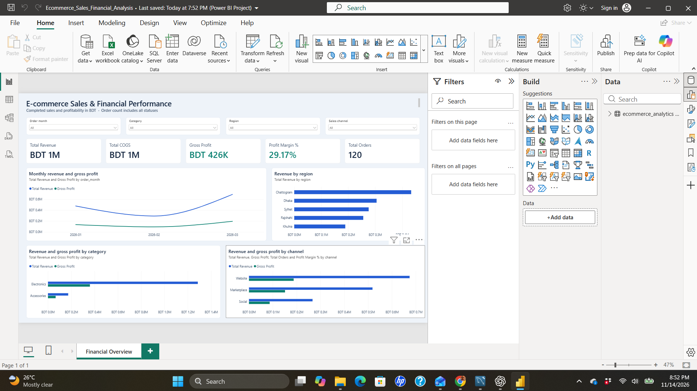

# E-commerce Sales & Financial Performance Analysis

A portfolio case study using fictional e-commerce data. This project connects Excel preparation, MySQL reconciliation, and a Power BI report so a reviewer can trace the dashboard totals back to individual orders.

## Dashboard preview



The screenshot shows the original verified report. The KPI table below gives the exact amounts shown in abbreviated form on the cards.

## Business problem

Order totals include pending and refunded transactions, which can overstate sales performance if all statuses are treated alike. The analysis separates order volume from completed-order sales and compares revenue and gross profit by month, product category, region, and sales channel.

## Dataset and preparation

The sample contains 120 order lines dated January 1 through March 31, 2026, with one row per order ID. It covers six products, two categories, five regions, and three sales channels. Fields include order and product IDs, order date, product, category, region, channel, quantity, unit price and cost, and status. All amounts are in Bangladeshi taka (BDT). The fictional records contain no customer names or contact details.

1. **Excel 2021.** The workbook preserves input values in `Sales_Raw`. `Sales_Analysis` derives the order month and calculates sales, cost of goods sold (COGS), gross profit, and completed-only amounts. `Data_Quality` checks key blanks, repeated order IDs, invalid quantities, negative prices or costs, and unexpected statuses.
2. **CSV.** The package includes one materialized export with ISO dates for MySQL import. The workbook also includes an executive summary and breakdowns by category, region, channel, status, and month.
3. **MySQL 8 and Workbench.** A typed demo table uses the order ID as its primary key and checks quantity, price, cost, and status. The analysis SQL reconciles totals and groups the data by month, category, region, channel, product, and status. It also checks duplicate IDs and invalid quantities or costs.
4. **Power BI Desktop and DAX.** The import model reads the MySQL table and aggregates the prepared financial columns. The **Financial Overview** page contains five KPI cards, a monthly revenue and gross profit trend, category and channel comparisons, a regional revenue chart, and dropdown slicers for order month, category, region, and channel. Codex assisted with project file editing and portfolio documentation.

## Financial KPIs

| KPI | Definition | Unfiltered result |
| --- | --- | ---: |
| Total Orders | Count all rows, including pending and refunded orders | 120 |
| Total Revenue | Sum quantity × unit price for completed orders | BDT 1,459,250 |
| Total COGS | Sum quantity × unit cost for completed orders | BDT 1,033,520 |
| Gross Profit | Sum completed sales less completed COGS | BDT 425,730 |
| Profit Margin % | Gross profit divided by revenue, with zero when revenue is zero | 29.17% |

The sample contains 99 completed, 11 pending, and 10 refunded orders. Completed-order revenue is a sales proxy. The dataset has no payment or refund timing and omits shipping, marketplace fees, taxes, and operating expenses. Three sample months support descriptive comparisons only.

## Findings and recommendations

- **Revenue is concentrated.** Electronics generated 88.1% of completed revenue, and monitors alone generated 62.1%. Track monitor availability and contribution before increasing inventory exposure.
- **March led sales and profit.** March generated BDT 689,300 in revenue and BDT 196,440 in gross profit. Monitor revenue accounted for 88.7% of the increase in revenue from February to March. Review unit volume and product mix over a longer period before using the change for planning.
- **Volume and margin tell different stories.** Website led channels in revenue and gross profit, while Social had the highest gross margin at 32.56%. Include acquisition, fulfillment, and platform costs before deciding where to increase spend.

See the [business insights report](BUSINESS_INSIGHTS.md) for segment tables and the [Upwork portfolio copy](UPWORK_PORTFOLIO.md) for a client-facing summary.

## Project structure

```text
GitHub_Portfolio/
├── README.md
├── BUSINESS_INSIGHTS.md
├── UPWORK_PORTFOLIO.md
├── PORTFOLIO_CHECKLIST.md
├── .gitignore
├── data/          Fictional sample CSV with ISO dates
├── excel/         Excel 2021 workbook
├── sql/           MySQL schema and analysis queries
├── dax/           Five measures installed in Power BI
├── power-bi/      PBIP entry point, PBIR report, and TMDL model
└── screenshots/   Dashboard screenshot and capture instructions
```

## Open and reproduce

1. **Excel.** Open the [workbook](excel/Ecommerce_Portfolio_Analysis.xlsx) in Excel 2021, allow recalculation, then review `Executive_Summary` and `Data_Quality`.
2. **MySQL.** Use Workbench to check whether `ecommerce_portfolio.sales` exists and contains the demo rows. If setup is needed, use [the setup script](sql/01_create_database.sql) on a local demo instance and import the [CSV](data/ecommerce_sales_mysql.csv) into the empty table, matching headers to columns. Run [the analysis queries](sql/02_business_analysis.sql) and compare the reconciliation result with the KPI table above.
3. **Power BI.** Keep the report and model folders alongside the [PBIP file](power-bi/Ecommerce_Sales_Financial_Analysis.pbip). Open it in Power BI Desktop with PBIP and PBIR support and a working MySQL connector. The showcase copy expects `localhost:3306` and `ecommerce_portfolio.sales`. Enter your own credentials through Power BI's data source settings and refresh to load the sample rows. If your demo instance uses a different server or port, change the Source step in Power Query before refreshing.
4. **Verify.** Clear the slicers, confirm all five KPIs, then select and clear one value in each slicer. If the currency cards abbreviate the amounts, use Format visual to set their callout display units to None for the exact-value check. The [DAX reference](dax/03_power_bi_measures.dax) documents the measures already installed in the project.

The original local Power BI report was verified in Desktop. The showcase copy uses the demo schema and omits the local import cache, so its first refresh is a separate validation step.

See the [dashboard capture instructions](screenshots/SCREENSHOT_INSTRUCTIONS.md) to update the preview and the [portfolio checklist](PORTFOLIO_CHECKLIST.md) for the remaining checks.

## Skills demonstrated

Excel formulas and data quality checks · MySQL schema design and SQL aggregation · Power BI report design and interactive filtering · DAX measures · Financial KPI reconciliation · Business interpretation and reproducible documentation

